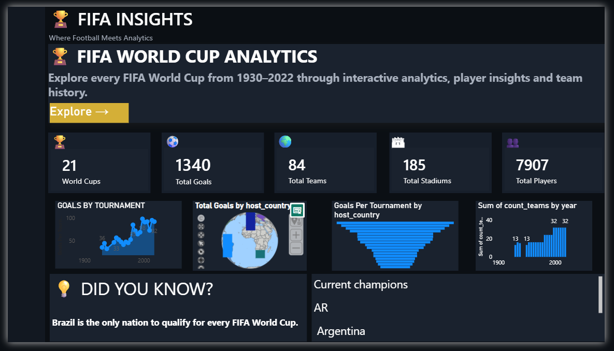
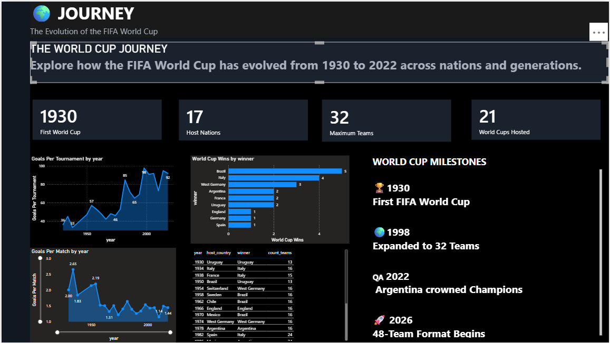
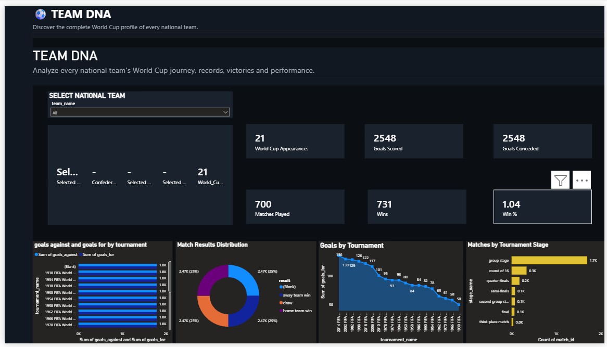
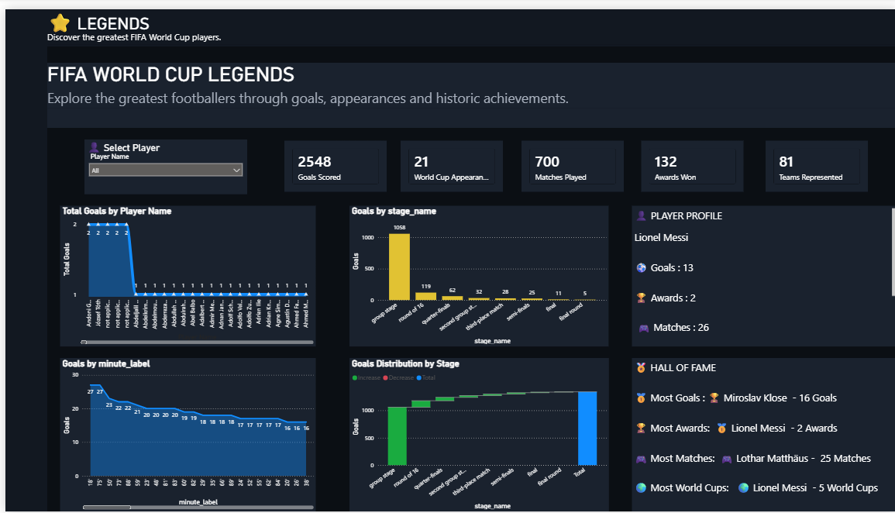
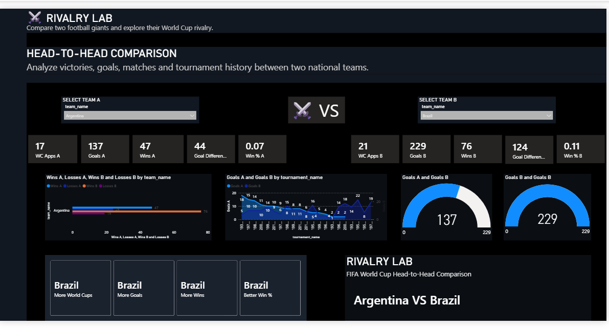
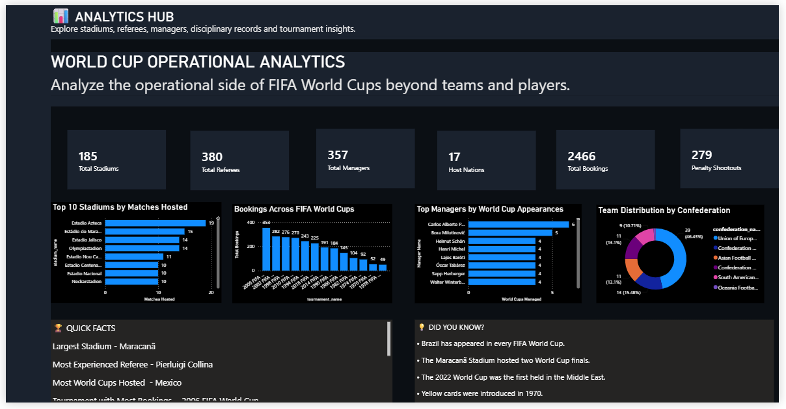

# ⚽ FIFA World Cup Analytics Dashboard

A six-page interactive **Power BI** dashboard exploring FIFA World Cup history (1930–2018) across tournaments, teams, players, rivalries, stadiums, referees, managers and discipline.

Built with **Power BI, DAX, Power Query and a relational data model** on 21 source tables (about 45,000 rows).



---

## 📌 Project Overview

The dashboard answers questions like:

- How has scoring changed from 1930 to today?
- Which nations have performed best, and how do two teams compare head-to-head?
- Who are the standout players, managers and referees?
- How have discipline, stadium use and confederation representation evolved?

**Data coverage:** 21 World Cups (1930–2018), 900 matches, 2,548 goals, 84 national teams, 185 stadiums.

---

## 🔎 Key Insights

All figures below were computed directly from the CSV files in [`Dataset/`](Dataset).

- **Scoring peaked early and has stabilised.** Goals per match hit a record **5.38 in 1954**, fell to a low of **2.21 in 1990**, and has stayed between **2.27 and 2.67** at every tournament since 1998.
- **Brazil is the benchmark.** It is the only team at all 21 tournaments, with **5 titles**, **76 wins in 109 matches (69.7%)** and a record **229 goals**. Germany is next-best on win rate (68.1%) among teams with 20+ matches, counted separately from West Germany.
- **Titles are concentrated.** Only **8 nations** have won the World Cup (counting Germany and West Germany as one). Brazil has 5, Italy 4, Germany/West Germany 4, and Argentina, France and Uruguay 2 each.
- **Hosting helps.** The host nation won the tournament **6 times in 21**.
- **Argentina vs Brazil:** in four World Cup meetings, Brazil leads with 2 wins to Argentina's 1, plus 1 draw. Goals are 5–3 in Brazil's favour.
- **Discipline has risen sharply.** Cards were first recorded in **1970 (1.6 per match)**. By **2018 that reached 3.5 per match**, and **2006** remains the most-booked tournament with **353 bookings (5.5 per match)**.
- **Knockout drama:** **30 matches** were decided by penalty shootout, with **70.3%** of the 279 kicks converted. **68 matches** went to extra time.
- **Europe dominates officiating.** UEFA provides **214 of 380 referees (56%)**. Ravshan Irmatov refereed the most World Cup matches (11).
- **Biggest win:** Hungary 10–1 El Salvador (1982). **Most-used venue:** Estadio Azteca with 19 matches.

---

## 📊 Dashboard Pages

### 🏆 Page 1 – Matchday
Tournament overview with KPI cards, goals by tournament, host-country map and a "Did you know?" fact panel.


### 🌍 Page 2 – Journey
Timeline of the tournament's evolution: goals per tournament and per match, titles by nation, host/winner history and key milestones.



### ⚽ Page 3 – Team DNA
Pick any national team to see appearances, goals, wins, results distribution, goals by tournament and matches by stage.



### ⭐ Page 4 – Legends
Player explorer with profile card, goals by stage and minute, awards and a Hall of Fame.



### ⚔️ Page 5 – Rivalry Lab
Choose Team A and Team B (via disconnected slicer tables) for a side-by-side comparison of appearances, goals, wins and win %.



### 🧭 Page 6 – Analytics Hub
The operational side of the tournament: top stadiums, bookings by tournament, top managers, referees and confederation distribution.



---

## ✨ Key Features

- Interactive page navigation and slicers
- Dynamic KPI cards and dynamic titles
- Team comparison using **disconnected tables**
- Custom dark dashboard theme
- Multi-page storytelling layout

### 📈 KPIs Included

Total Goals · Total Matches · World Cup Appearances · Wins · Goal Difference · Win Percentage · Stadium Count · Referee Count · Manager Count · Bookings · Penalty Shootouts · Confederation Distribution

---

## 🛠️ Tools & Technologies

- Microsoft Power BI Desktop
- Power Query (data cleaning and shaping)
- DAX (measures and dynamic titles)
- Data modeling (star schema, one-to-many relationships)
- Bookmarks, navigation and interactive filters

---

## 📚 Dataset

The 21 CSV files in [`Dataset/`](Dataset) follow the structure of the **Fjelstul World Cup Database** (Joshua C. Fjelstul), which is published at [github.com/jfjelstul/worldcup](https://github.com/jfjelstul/worldcup) under **CC BY-SA 4.0**. Every table uses the same ID keys (`tournament_id`, `team_id`, `match_id`, `player_id`, `referee_id`, `manager_id`, `stadium_id`), which is what the dashboard's relationships are built on.

| Group | Tables |
|---|---|
| Teams & results | `team_appearances`, `qualified_teams`, `group_standings`, `groups`, `tournament_standings`, `tournament_stages`, `host_countries` |
| Players | `player_appearances`, `squads`, `substitutions`, `bookings`, `penalty_kicks`, `award_winners`, `awards` |
| Officials | `referees`, `referee_appointments`, `referee_appearances`, `managers`, `manager_appointments`, `manager_appearances` |
| Reference | `confederations` |

Largest tables: `player_appearances` (18,623 rows), `squads` (10,142), `substitutions` (6,464), `bookings` (2,466), `team_appearances` (1,800).

---

## 📊 Data Modeling

- Star schema with fact tables (appearances, bookings, substitutions, penalty kicks) and dimension tables (teams, tournaments, players, referees, managers, confederations)
- One-to-many relationships on the shared ID keys
- Disconnected tables for the Team A / Team B selectors in Rivalry Lab

---

## 📂 Repository Structure

```
FIFA-World-Cup-Analytics-Dashboard/
├── Dashboard/
│   └── FIFA_World_Cup_Analytics.pbix
├── Dataset/
│   └── 21 CSV files
├── Images/
│   ├── Matchday.png
│   ├── Journey.png
│   ├── TeamDNA.png
│   ├── Legends.png
│   ├── RivalryLab.png
│   └── AnalyticsHub.png
├── README.md
└── LICENSE
```

## ▶️ How to Open

1. Install [Power BI Desktop](https://powerbi.microsoft.com/desktop/) (Windows).
2. Open `Dashboard/FIFA_World_Cup_Analytics.pbix`.
3. If Power BI asks you to refresh or locate data sources, point them at the `Dataset/` folder.

---

## 🚀 Future Enhancements

- Extend the data to the 2022 and 2026 tournaments
- Drill-through pages for team and player detail
- Custom tooltips on the main charts
- Mobile layout
- Forecasting goals per match with Python

---

## 👨‍💻 Developed By

**Hemanth Reddy**
B.Sc. Economics (Data Science), Shiv Nadar University Chennai

---

## 📄 License

The report and documentation are released under the [MIT License](LICENSE). The underlying dataset remains under its original CC BY-SA 4.0 license (see **Dataset** above).

⭐ If you found this project interesting, consider giving it a star!
